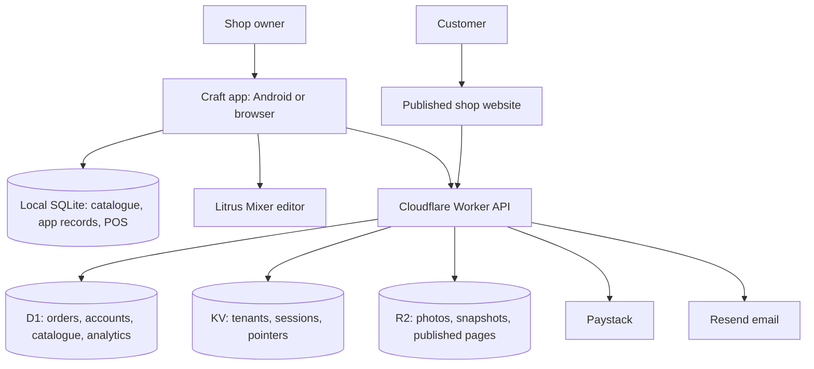

# About Craft — the full picture

*Written 2026-11-23. This is the one document to read first. It explains what Craft is, what it does, how it is built, where it runs, how money moves, and what is still open. The detailed documents it points to go deeper; when any document disagrees with the code, the code is right.*

---

## 1. What Craft is

**Craft** (code name *E-Shop Atelier*) is a mobile-first app that lets a small business owner do three things from one phone:

1. **Build a website** for the business (products or services, with a cart or booking calendar).
2. **Sell in person** with a point-of-sale (POS) register that works offline.
3. **Understand the business** with reports and an AI helper.

The one-line pitch: **“Build your business website in minutes. Run your business with Craft.”** (“In minutes” is the goal of the guided setup, not a promise.)

**Who it is for:** small shop and service owners who want a real online shop and a till without hiring a developer or an accountant. It started in Kenya and is being opened to English-speaking Africa: **Kenya, Nigeria and South Africa** are supported for online payments (see section 8).

**Who uses it:**

| Person | What they do |
|---|---|
| **Shop owner** | Uses the Craft app (Android, or a browser) to build the site, manage products, take orders, run the POS and read reports. |
| **Customer** | Opens the owner's published website in any browser, browses, adds to cart, pays or books. No app needed. |
| **Craft team** | Runs the hosted service (Cloudflare), the official Craft website and the marketing. |

---

## 2. What you can do with it

### 2.1 Website builder (Litrus Mixer)

- **Litrus Mixer is the only website editor.** There is no theme gallery. The old themes, Theme Studio, the standalone builder storefront and the live-websites flow were removed on purpose and are not coming back (see `THEME-ENGINE-HANDOFF.md`).
- The owner creates a shop, says whether it sells **products** or **services**, enters name and details, picks a look and style, adds products or services, categories and photos, plus content blocks such as promo cards and FAQs.
- The owner previews on **phone, tablet and laptop** sizes, then taps **Publish**. Nothing reaches customers until Publish; saved-but-unpublished changes stay private.
- Every shop gets its own address (`<shop>.<domain>`) and can connect a **custom hostname**.
- Product photos are compressed on the phone (WebP, up to 1800 px / 1.5 MB), uploaded on publish and reused when unchanged.
- Products support **variants and attribute pricing** (options with their own prices and stock).

### 2.2 Selling products online

- Customers get a **cart and checkout** (name, contact, delivery address or pickup). The owner sets a delivery fee and a free-delivery threshold.
- **The server works out prices, stock and discounts itself.** Nothing the browser says about prices is trusted.
- Two ways to pay:
  - **Online with Paystack** (card, bank and mobile options Paystack offers in the shop's country), or
  - **Order now, pay the shop directly** (cash, mobile money, bank transfer). The owner then records the payment in the Orders screen with an optional reference such as an M-Pesa code.
- An order counts as **paid only** when Paystack confirms it or the owner records it.
- **Holds:** customers can reserve an item for a limited time; the owner can release or reject holds.
- **Discount codes:** percent or fixed amount, optional minimum spend, dates and usage limit.
- Shops can also show **direct-pay instructions** (M-Pesa Till/Paybill/phone, cash, bank transfer). These are display text only; no money moves through them.

### 2.3 Services and bookings

- A service shop shows an **appointment picker** instead of a cart. The owner sets open days, hours, a time buffer, capacity and an optional **deposit percentage**.
- The customer sends a **request**; the time is held for up to 24 hours while the owner **confirms or declines**.
- If a deposit is required, confirming creates a **Paystack payment link**. The booking is not paid until Paystack confirms.
- Customers get a link to view, move or cancel the booking until a cutoff (2 hours by default). Confirmed customers get a reminder email about a day before.
- The owner can mark a started appointment completed or no-show. A paid-deposit cancellation is only **flagged**; the owner refunds in Paystack.

### 2.4 The owner's day-to-day

- **Orders:** web orders, payment status, and anything that **needs attention** (money received but stock short, payment after cancellation, duplicate payment).
- **Alerts:** owners are emailed (when email is set up) and see an in-app list for new orders, booking requests and holds.
- **Reports:** visits, product interest and funnel counts (checkout started, purchases, booking requests) once the site is published and connected.
- **Newsletters:** subscribers confirm their email before receiving campaigns.
- **Multiple shops:** one account can own several shops; each has its own website and catalogue.

### 2.5 Point of sale (POS)

- Offline-first register: products, categories, prices, stock, sales, receipts, invoices, expenses, till in/out, till closing, customer balances and part-payments.
- Barcode and text scanning on Android (ML Kit).
- Reports: sales over time, expenses, product and category performance, stock, payment mix, customers, alerts (low stock, overdue balances). Profit needs product costs entered correctly.
- **POS and website catalogues are separate.** Editing one does not change the other unless the owner uses the explicit shared-inventory and import features. An in-person sale is not a web order.
- POS data stays on the device unless the owner turns on **cloud backup** or **nearby device sync** (Bluetooth on Android, QR pairing). Nearby sync can carry customer names and phone numbers, so connect only trusted devices.

### 2.6 Insights and the AI helper

- Business reports summarise POS records and, where connected, website activity.
- An **AI helper** on supported screens explains reports and answers questions from the information on that screen. It is a suggestion tool, not an accountant, tax, legal or financial adviser. It works only when the AI service is configured.

---

## 3. Screen map (owner app)

| Area | What is there |
|---|---|
| **Home** | Overview of the business and shortcuts. |
| **Account / Profile** | Sign in (email + password, or Google), recovery email, website settings, domains. |
| **Web Studio** | Main shop workspace and dashboard, Products, Categories, Inventory, shop/tenant picker, website pages and store details, Orders, Payments, Discounts, Bookings, Newsletters, Notifications. |
| **Website editor** | The Litrus Mixer editor in an iframe: setup wizard, editor, device previews, Publish. |
| **Payments** | Paystack bank/account setup (bank list follows the shop's currency), account reuse across shops, website currency, “ways customers can pay you directly”. |
| **POS** | Sell, Overview/reports, Catalogue, Orders, Sales and receipts, Customers, More (expenses, till, register instances), sync. |
| **Business reports (“Lens”)** | Filtered business reporting and the AI helper. |

Full screen-by-screen detail: `APP_GUIDE.md`.

---

## 4. How it is built

### 4.1 The stack

| Layer | Technology |
|---|---|
| App | **Vite** web app in **vanilla JavaScript** (no UI framework). |
| Android | **Capacitor** shell; native SQLite (`@capacitor-community/sqlite`), camera, share, filesystem, browser, ML Kit barcode and text recognition. |
| Browser | Same app; SQLite WebAssembly (`jeep-sqlite`) stored in IndexedDB. |
| Backend | One **Cloudflare Worker** (`cloudflare/worker.js`) serving the API, the published storefronts and the static app. |
| Hosted data | **D1** (SQL), **KV** (tenants, sessions, pointers), **R2** (media, snapshots, published sites). |
| Payments | **Paystack** (subaccounts, checkout, signed webhook). |
| Other services | Turnstile (bot protection), Google OAuth, Resend (email), Web Push, an AI model provider, Cloudflare for SaaS (custom hostnames). |

### 4.2 System map

### 4.3 Key ideas

- **Local-first.** Drafts and the POS live in the phone's SQLite database. The cloud is used for publishing, accounts, customer commerce, optional backup and sync.
- **Tenants.** Each shop is a tenant with its own catalogue, credentials and published site. Requests resolve a tenant from the hostname or `?tenant=`, then go through per-action authorisation.
- **The server is the authority** for prices, stock, discounts and payment state. The browser is never trusted.
- **Publishing** sends the design, catalogue and photos to the Worker, which stores the catalogue in D1, the finished page in R2 and a pointer in KV.
- **Secrets** (Paystack, Google, Resend, AI, push, admin keys) live only in Cloudflare secret storage, never in the app or the repository.

### 4.4 Folder layout

| Path | Holds |
|---|---|
| `index.html` | The app shell, routes, owner screens and controller. On the `integrate/split-merge` branch this large file is split into modules under `src/app/` and `src/screens/`. |
| `src/` | Modules: `pos.js`, `sqlite.js`, `business-lens.js`, `craft-ai*.js`, `product-*.js`, `attribute-pricing*.js`, `theme-catalog.js` (lists only Litrus Mixer), and more. |
| `public/litrus-mixer/` | The editor, the live storefront runtime (`live-catalog.js`) and a phone mock. |
| `public/official-site/` | Fallback Craft homepage served by the Worker. |
| `cloudflare/` | `worker.js`, `seo.js`, Wrangler configs, `migrations/` (D1 SQL), Cloudflare-side docs. |
| `android/` | Capacitor Android project (do not hand-edit unless changing native code). |
| `www/` | Build output; also what the Worker serves as static assets. Regenerate, never hand-edit. |
| `tests/` | Node tests (`node --test`). |
| `scripts/` | Boot and browser smoke tests, linting, owner-link helper. |
| `archive/` | Retired M-Pesa notification code (reference only). |

### 4.5 The Worker's API (summary)

Auth and accounts (`/api/auth/*`), tenants and catalogue (`/api/tenants`, `/api/catalog`), publishing and media (`/api/theme-publish`, `/api/media`), orders and manual payments, discounts, notifications, Paystack (`/api/payments/paystack/*`: banks, subaccount, link, default, checkout, webhook), service appointments, holds and product interest, newsletters, analytics, business sync and POS record deltas, nearby pairing, shared inventory, push, AI assistant, custom hostnames. Public routes: `/`, `/robots.txt`, `/sitemap*.xml`, `/manifest.webmanifest`, `/shops`, `/products/<slug>`.

Contract for the commerce endpoints: `cloudflare/STOREFRONT_COMMERCE.md`. Route table and details: `APP_ARCHITECTURE.md`.

---

## 5. Where Craft runs (domains and deployments)

Craft can serve more than one domain. The domain is chosen at build time (`VITE_DOMAIN_ROOT`, and `VITE_MAIN_HOST` when the root already hosts another site) and on the Worker (`DOMAIN_ROOT`, `MAIN_HOST`).

| Deployment | Domain | Main app address | Shop addresses | Cloudflare account |
|---|---|---|---|---|
| **rrobin.co.ke** (original) | `rrobin.co.ke` | `rrobin.co.ke` | `<shop>.rrobin.co.ke` | Original account (Worker `eshop-storefront`) |
| **craft.ke** (new) | `craft.ke` | **`app.craft.ke`** | `<shop>.craft.ke` | New account (Worker `craftke-storefront`) |

Notes on **craft.ke**:

- The apex **`craft.ke`** and **`www.craft.ke`** show the **official Craft website** (a separate Worker named `craft`, source folder `crafty`). The Craft *app* lives on **`app.craft.ke`**, so the two never collide.
- These names are reserved and never given out as shop addresses: `app` (the main app), `www`, `pos`, `crafty`, `craf`, `webbuilding`, `webbuilderinkenya`, `webbuildercraftke`, `craftwebandposbuilder` and `safiri`.
- The Worker route is `*.craft.ke/*` only, never `craft.ke/*`, so the official site is unaffected.
- The Android build for craft.ke uses app id **`ke.craft.app`** (installs beside the original app, `com.eshop.atelier`), a WebView host of `craft.ke`, and calls `https://app.craft.ke` by default. It is built with `npm run build:craftke` and `.env.craftke`.
- Craft's own **D1, KV and R2** for craft.ke are separate resources in the new account (`craftke-catalog`, a KV namespace, `craftke-business-archive`).
- The craft.ke support (main host, per-domain config, tests) is on branch **`integrate/split-merge`** and is **not yet merged into `main`**.

**Other apps on these domains.** Around 27 separate small apps and sites (for example `litrus`, `vertex`, `apexpos`, `jamii`, `chesser`) stay in the original Cloudflare account and are reachable on `<name>.rrobin.co.ke`. The product-pages site (`apps.rrobin.co.ke`) and app downloads (`downloads.rrobin.co.ke`) also use rrobin names. Only the official craft.ke site moved with the craft.ke domain.

---

## 6. Data and privacy

- **On the phone:** the website catalogue, drafts, app records and POS data in one SQLite database (JSON-payload tables for catalogue/app records; relational tables for POS).
- **In the cloud (after Publish):** the shop's catalogue, shop info, finished page and photos. Each shop is separate.
- **Orders and payments:** relational rows in D1 with uniqueness constraints so a payment cannot settle an order twice.
- **Payment details:** Craft stores only a Paystack reference and masked bank details, never full account numbers or card data.
- **Passwords and sessions** are handled on the server; shop credentials are stored as hashes.
- **Keep safe:** protect the device, and share shop access or sync data only with trusted people and devices.

---

## 7. Notifications and email

Order, booking and hold alerts to the owner, newsletters, booking links and reminders, and account recovery all need the **email service** (Resend) to be set up with the domain verified. Without it the app still works; those messages simply do not send. Push notifications need the owner's permission and push keys.

---

## 8. Payments in detail

### 8.1 Paystack and the markets it covers

Paystack is Craft's online payment provider. It operates in **Nigeria, Ghana, South Africa, Kenya** and a growing list of others (check paystack.com for the current list).

Craft supports Paystack online payments in these shop currencies:

| Shop currency | Country | Bank list shown | Status |
|---|---|---|---|
| **KES** | Kenya | Kenyan banks | Supported |
| **NGN** | Nigeria | Nigerian banks | Supported in code and live on the craft.ke server; needs NGN enabled on Craft's Paystack account for live payments |
| **ZAR** | South Africa | South African banks | Same as NGN |

How it works:

- Each shop connects a **bank account** under Payments. Craft creates a **Paystack subaccount** (0 % platform charge; the shop bears fees) and checkout pays out to it.
- The bank list is loaded for the shop's own currency (`/api/payments/paystack/banks?currency=KES|NGN|ZAR`).
- Checkout, service deposits and booking deposits accept **KES, NGN and ZAR**; any other currency is refused with a clear message and the shop falls back to paying the shop directly.
- In Live mode the bank account is verified with Paystack before a subaccount is created; in Test mode it cannot be.
- **Paystack settles in the currency of the account it sends to.** For live NGN/ZAR payments Craft's own Paystack business must have those currencies switched on.
- The app can show a website currency list (KES, USD, EUR, GBP, TZS, UGX, RWF, NGN, GHS, ZAR). Only KES, NGN and ZAR can take Paystack payments; others work with pay-the-shop-directly.

### 8.2 Manual and direct payments

- **Order and pay the shop directly** works in any currency: the customer places the order, pays the shop outside Craft, and the owner records it.
- **M-Pesa** instructions (Till, Paybill, phone) are Kenya-specific display text the owner can show at checkout. Shops in other countries simply turn it off and use bank transfer or cash instead.

### 8.3 Connecting Paystack on a new deployment

Webhook URL to set in Paystack: `https://<main-app-host>/api/payments/paystack/webhook` (for craft.ke: `https://app.craft.ke/api/payments/paystack/webhook`). Without it, paid orders are not marked paid.

### 8.4 Stripe (not built)

Customers outside Paystack's countries cannot use Paystack. The planned route is **Stripe Connect** (shop owners connect their own Stripe account with a button; no pasted API keys; Craft can take a fee). It is a design option only; nothing is built, and Stripe does not fully serve Kenyan businesses.

---

## 9. Build, run, test, deploy

| Command | Purpose |
|---|---|
| `npm install` | Install dependencies. |
| `npm run dev` | Vite dev server. |
| `npm run build` | Build into `www/`. |
| `npm run build:craftke` | Build for the craft.ke domain (uses `.env.craftke`). |
| `npm test` | All tests (`tests/*.test.mjs`). |
| `npm run test:pos` / `npm run test:cloudflare` | POS tests / Worker tests (sql.js in-memory D1). |
| `npm run lint:inline` | Lint the inline app script. |
| `npm run test:boot` | Boot the production build in headless Chromium (build first). |
| `npm run test:litrus-browser` | Playwright smoke test of the editor and preview. |
| `npm run cap:sync` | Build and sync to the Android project. |
| `npm run cf:dev` | Local Worker with local D1/KV/R2. |
| `npm run cf:d1:migrate:local` / `cf:d1:migrate:remote` | Apply D1 migrations locally / to **production**. |
| `npm run cf:deploy` | Build and deploy to **production** (manual step). |

**Android:** Android Studio and SDK, `npm install`, `npm run cap:sync`, `npx cap open android`. App id `com.eshop.atelier` (rrobin build) or `ke.craft.app` (craft.ke build). Debug APKs are test builds; a **signed release build** is needed for the Play Store. Turnstile needs one allow-listed WebView hostname (`rrobin.co.ke` or `craft.ke`).

**Deploying the Worker (craft.ke):** `npm run cf:craftke:deploy` (builds with `--mode craftke`, then deploys `cloudflare/wrangler.craftke.jsonc` with `--profile default`, which is the new Cloudflare account). Always pass the profile: on some machines the active login is the original account, and a deploy without it goes to the wrong account.

**Deploying is manual.** Apply database migrations first, then deploy the Worker. Nothing in the repository deploys automatically, and automated agents must not.

**Verification status (last run):** Worker tests 117/117; main suite 624/625 (the one known failure needs a gitignored Android file); POS tests 71/71. Tests use stubs and sql.js, not real Paystack, Resend or Cloudflare.

---

## 10. Current state (2026-11-23)

**Done**

- Litrus Mixer editor, publish pipeline, product and service shops, variants and attribute pricing.
- Storefront commerce on the Worker: server-side pricing, holds, discount codes, manual and Paystack payments, owner alerts, bookings with deposits and self-service.
- POS with offline operation, scanning, reports, cloud backup and nearby sync.
- craft.ke live: official site on `craft.ke` and `www.craft.ke`; Craft app on `app.craft.ke`; shops on `<shop>.craft.ke`; craft.ke Android APK built.
- Paystack for **KES, NGN and ZAR**: committed (`7d6f754`) and the Worker deployed to craft.ke.

**Open before marketing**

1. **Google sign-in:** add redirect `https://app.craft.ke/api/auth/google/callback` in Google.
2. **Paystack webhook:** set `https://app.craft.ke/api/payments/paystack/webhook`.
3. **Paystack currencies:** have NGN and ZAR enabled on Craft's Paystack account.
4. **Resend:** verify `craft.ke` so email sends from the domain.
5. **Real-phone test:** install the APK, create an account, build a shop, add a product, place a test order. Sign-up, payments and email on `app.craft.ke` have not been tested end to end by a person.
6. **New Android build** so the app includes the NGN/ZAR change (the first craft.ke APK predates it).
7. **Signed release build** and store listing, icon and privacy policy for Google Play.
8. **Plan pricing:** plan prices are shown in KES; decide what Nigerian and South African shops pay.
9. **Copy for other countries:** some text is Kenya-flavoured (M-Pesa, `en-KE` price formatting).
10. **D1 migrations `0025`–`0030`** exist as files and must be applied to each production database before the Worker code that needs them runs.
11. **Merge** `integrate/split-merge` (craft.ke support and the Paystack currencies) into `main`.
12. Save the **publish token** that was shown once when craft.ke was set up.

**Decisions still open**

- What happens to stock and money when a **paid order is cancelled** (today it neither restocks nor refunds).
- Whether Litrus shops need **category and custom-page URLs** (today only the home page and products have real URLs).
- Removing the **dead theme-engine code** and the older tests that still read it.
- Whether to build **Stripe Connect** for markets Paystack does not cover.

---

## 11. Known limits

- Cancelling a paid order does not restock and does not refund; the owner does both by hand.
- Rate limits protect the database, not one shop's speed under a large coordinated attack.
- Only the home page and product pages have real URLs and search-engine entries.
- The owner app has confirm and decline buttons for appointments; other owner actions exist on the server but have no buttons yet, and the capacity and cutoff settings have no controls.
- Reports show only what was recorded; an empty report may mean nothing was recorded yet.
- A website's catalogue and the POS catalogue are separate on purpose.
- “Test mode” Paystack cannot confirm payouts.
- Craft is not an accounting, tax, legal or financial adviser.

---

## 12. Where to read next

| Document | For |
|---|---|
| `README.md` | Quick start, folder layout, commands. |
| `APP_OVERVIEW.md` | The owner-facing explanation of the product. |
| `APP_GUIDE.md` | Screen-by-screen guide and the source map for maintainers. |
| `APP_ARCHITECTURE.md` | System map, data model, Worker routes, schema history. |
| `cloudflare/STOREFRONT_COMMERCE.md` | The storefront commerce API contract. |
| `cloudflare/CRAFTKE-SECRETS.md` | Which secrets the craft.ke Worker needs (names only) and where to set them (on branch `integrate/split-merge`). |
| `cloudflare/GOOGLE_SIGN_IN.md`, `BUSINESS_SYNC.md`, `AI_ASSISTANT.md`, `GOOGLE_SEARCH_CONSOLE.md` | Individual integrations. |
| `ROADMAP.md`, `PROJECT_LOG.md` | History and older priorities (partly superseded by section 10 above). |
| `THEME-ENGINE-HANDOFF.md` | Why the old themes were removed and what is dead code. |
