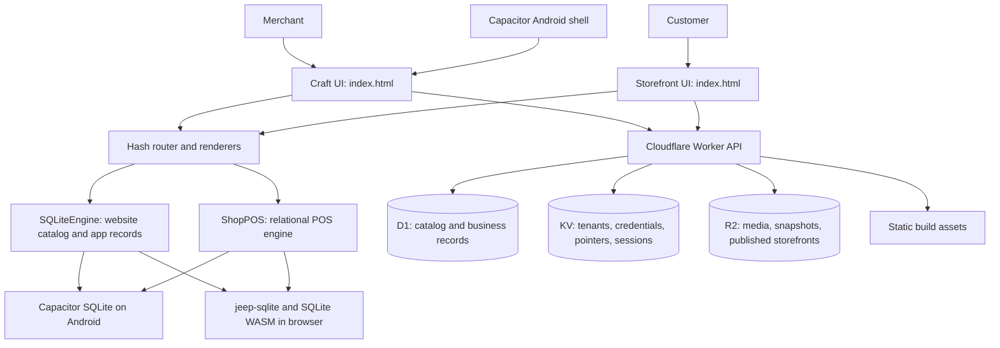

# Craft App Architecture — Current State

This document describes the application represented by the source in this
repository. It covers the mobile/web frontend, local data, the Cloudflare
backend, storefront publishing, integrations, and how the pieces connect.
Implementation details can change; the source files named below are the
authority when this document and runtime behavior differ.

## 1. What the application is

Craft is a mobile-first web application packaged for Android with Capacitor.
It brings together:

- A customer-facing storefront with catalog, search, product/category pages,
  cart, checkout, account, and custom content pages.
- A merchant workspace for website setup, catalog management, orders,
  customer tools, reports, payments, and shop configuration.
- A point-of-sale (POS) register and local business record system.
- Optional Cloudflare-backed publishing and services for multiple shops.

The app is not a conventional frontend/backend pair where every screen reads
and writes to a remote API. Much of the app works against a local SQLite
database. The Cloudflare Worker is a separate hosted backend used for account
and shop access, publishing, customer storefront operations, and optional
business synchronization.

## 2. System map

### Main code areas

| Area | Source |
|---|---|
| Main application, routes, storefront and merchant renderers, styles | `index.html` |
| Browser and native module startup | `src\bootstrap.js` |
| Catalog/app-data SQLite adapter | `src\sqlite.js`, `src\sqlite-snapshot.js` |
| POS database, screens, transactions, reports, scanning and sync | `src\pos.js` |
| Business reporting workspace and filters | `src\business-lens.js` |
| AI helper UI and local POS context preparation | `src\craft-ai.js` |
| Push subscription client | `src\business-notifications.js`, `public\sw.js` |
| Website theme definitions and appearance options | `src\theme-catalog.js`, `src\website-appearance-presets.js` |
| Liquid theme renderer | `src\liquid-storefront-renderer.js` |
| HTML-theme renderer bridge | `src\liquid-html-theme-renderer.js`, `public\liquid-html-theme-renderer.js` |
| Theme editor/importer and storefront runtime | `public\liquid-themes\theme-studio.html`, `public\theme-importer.js`, `public\theme-catalog-adapter.js` |
| Hosted API and storefront delivery | `cloudflare\worker.js` |
| Hosted schema history | `cloudflare\migrations\` |
| Cloudflare resource/route configuration | `cloudflare\wrangler.jsonc` |
| Android wrapper configuration and manifest | `capacitor.config.ts`, `android\app\src\main\AndroidManifest.xml` |

## 3. Frontend and startup

### Application shell and UI

`index.html` is the primary Vite entry and contains a large amount of the
application: the storefront markup and styles, merchant and Web Studio
renderers, initialization logic, event binding, and the `AppController`.
It is a vanilla JavaScript application rather than a React/Vue application.
The UI is generally rendered by producing HTML strings and assigning them to
the `#app` element.

Navigation uses URL hashes, for example `#/account/web/studio/store/products`
and `#/pos/catalogue/inventory`. `AppController.currentRoute()`,
`navigate()`, and `handleRoute()` in `index.html` interpret the route and
select the appropriate renderer. Global click handling intercepts in-app
links; browser hash changes drive back/forward navigation. This allows the
same app entry to work from a browser URL and inside the Capacitor WebView.

`StudioRenderers`, `StoreRenderers`, and `PageRenderers` provide most of the
screen HTML in `index.html`. POS screens are rendered by `ShopPOS` from
`src\pos.js`. Styles are primarily in the app HTML and supplemented by
module-specific stylesheets such as `src\browser-register.css`.

The Craft visual-system class is applied to app-shell routes. The main
Theme Studio editor route (`/account/web/site`) is deliberately excluded from
that app-only style gate so app-shell styling does not become storefront
editor styling.

### Startup sequence

1. Vite loads `index.html` and its `src\bootstrap.js` module.
2. `bootstrap.js` installs the browser/native module bridges, creates
   `window.ShopPOS`, and starts `initializeSQLite()`.
3. The POS engine initializes after SQLite is ready. `AppController.init()`
   waits for `window.ShopPOSReady` before it reads catalog state.
4. `SQLiteEngine.init()` restores the saved app snapshot or initializes its
   app catalog data. It handles the current startup catalog-import flow.
5. The app binds navigation and events and renders the URL's initial route.
6. In production, the module registers `public\sw.js` as the service worker.

The Capacitor module also listens for native back-button events and app URL
opens. Google sign-in can return through the `com.eshop.atelier://auth/google`
Android deep link declared in the manifest.

### Main screen families

- **Storefront:** `/web`, `/categories`, `/category/...`, `/product/...`,
  `/search`, `/bag`, `/checkout`, `/checkout/confirmation`, `/favorites`, and
  `/pages/...`.
- **Craft home and account:** `/`, `/account`, `/app-account`, and
  `/account/profile...`.
- **Web Studio and shop management:** `/account/web/studio/...`,
  `/account/main-shop...`, `/store/...`, `/account/products`,
  `/account/categories`, `/account/inventory`, `/account/tenants`,
  `/account/payments`, `/account/website...`, and `/account/web/pages`.
- **Point of sale:** `/pos` and `/pos/...`.
- **Website/theme editing:** `/account/web/themes...` and
  `/account/web/site`; the latter hosts the theme editor experience.

Web Studio groups screens into Dashboard, Store, CRM, Websites, and Payments.
Its Store tabs include products, categories, inventory, and orders/bookings.
The app also contains reporting screens for sales, visits, traffic,
performance, product intelligence, customers, finance, and marketing.

### Android and browser runtimes

`capacitor.config.ts` names the Android app `Craft` with application ID
`com.eshop.atelier`, serving the built `www` directory. A normal Android
build uses the configured app hostname. A development live-reload URL can be
supplied with `CAPACITOR_LIVE_RELOAD_URL`; that mode requires the development
server and phone-to-computer connection to remain available.

The Android plugin registry includes SQLite, app lifecycle/deep links,
in-app browser, camera, filesystem, sharing, ML Kit barcode scanning, and
text recognition. The manifest declares network, camera, and Bluetooth
permissions; platform and Android-version behavior may affect permission
prompts and scanner availability.

The browser/PWA SQLite path uses `jeep-sqlite` and SQLite WASM storage. The
service worker caches selected shell assets and successful same-origin GET
responses, but does not cache navigation requests; this is not a complete
offline snapshot of every app page or backend feature.

## 4. Local data and persistence

### App/catalog store

`src\sqlite.js` initializes the Capacitor SQLite connection named `eshop`.
On Android it uses the native Capacitor SQLite plugin. On the web it
initializes `jeep-sqlite` and saves the database to the browser store. Its
`window.ShopSQLite` bridge serializes operations through a queue and exposes
`load`, `save`, `query`, `run`, `execute`, `executeSet`, `scheduleSave`, and
`flush`.

The app-level `SQLiteEngine` in `index.html` reads/writes tables through that
bridge. It stores each row as a JSON payload in a table keyed by app dataset.
Current logical datasets include store settings, categories, products,
pages, inventory, favorites, cart items, orders, hero slides, plans,
analytics, tenant catalogs, website themes, visits/events, newsletter
records, booking holds, loyalty points, payment-method metadata, studio
settings, and main-store allocation records. This is separate from the
normalized relational tables used by POS.

The SQLite adapter can migrate an older browser `ESHOP_SQLITE_DB_V1`
snapshot. A one-time storefront catalog import runs only when the relevant
catalog is empty. Tenant selection and certain editor/appearance preferences
also use browser local storage; not every setting is kept in SQLite.

### POS database

The POS engine in `src\pos.js` creates relational tables in the same local
SQLite database, but keeps the POS catalog and records distinct from the
website catalog. Its schema includes:

- POS categories, products and settings.
- Sales, sale line items and payment entries.
- Invoices and invoice items.
- Expenses, cash movements and till closes.
- Suppliers, purchases and tickets where those workflows are used.
- Business instances for scheduled, timed, paused, and counted sessions.
- Cloud sync records/outbox and queued inventory events.
- Shared inventory, shared inventory events, and their line items.

Prices and amounts are stored as integer cents in the relational POS schema.
Foreign keys, uniqueness constraints, indexes, and stock checks protect
important local operations. POS handles sale creation, payment recording,
receipts, partial payments, invoices/quotations, purchases, cash handling,
settings, and reports. The POS screen and business analytics are computed
from recorded data; cost-based profit estimates are incomplete when buying
costs have not been recorded.

Products in the online catalog and POS catalog are not one universal product
table. The app has explicit import/bridge and shared-inventory features, but
users should not assume that every edit or stock movement automatically
propagates between both catalogs.

### Data ownership boundaries

| Data | Main location | Remote behavior |
|---|---|---|
| App website draft/catalog and local settings | Device/browser SQLite, with some local-storage preferences | A selected catalog can be published to its shop. |
| POS register and records | Device/browser SQLite | Optional Cloudflare business-record sync and inventory services. |
| Account and shop identity | Cloudflare D1/KV | Used for sign-in and shop-scoped authorization. |
| Published catalog and orders | Cloudflare D1 | Read publicly where the route allows; writes are action/auth dependent. |
| Product media and filled published storefronts | Cloudflare R2 | Served through constrained Worker routes and tenant paths. |
| Theme editor draft/export | Browser memory/iframe messaging, then saved app/theme state | Saved locally until catalog/theme publish. |

## 5. POS, reporting and auxiliary frontend modules

`src\pos.js` exports `createPosApp()`, which owns POS state and rendering,
database initialization and mutations, scanner integration, and sync
workflows. The user-facing areas include Sell, Overview, Catalogue
(products/categories/inventory/suppliers), Orders, invoices/quotations, Sales
and receipts, Customers, and More/settings.

Barcode/QR scanning uses native ML Kit where available and browser-based
scanner libraries where applicable. Text recognition and image matching
support product lookup/catalog workflows. These are assisted capture and
matching tools; the saved product and sale records remain in the local
database.

`src\business-lens.js` renders the more detailed business workspace. It
normalizes a snapshot, applies date/filter context, and derives sales,
channels, products, inventory, customers, finance, marketing, newsletter and
category views. Its observations depend on the input records and include
minimum-sample/cost-coverage limitations in the relevant views.

`src\craft-ai.js` adds the in-app assistant panel on eligible business
screens. It prepares a bounded local POS analytics context and calls the
Worker AI endpoint when available. It is not the source of truth for
transactions or accounting.

`src\business-notifications.js` handles browser push permission, subscription
creation and removal. `public\sw.js` displays push notifications and routes a
click back into the app.

## 6. Cloudflare backend

### Runtime and bindings

`cloudflare\worker.js` is the Cloudflare Worker entry point. The current
`cloudflare\wrangler.jsonc` configures:

- **D1 (`DB`)** for relational account, catalog, orders, analytics, inventory,
  and synchronization records.
- **KV (`TENANTS`)** for tenant metadata, hashes/pointers, temporary sessions
  and other keyed state.
- **R2 (`BUSINESS_ARCHIVE`)** for uploaded media, business snapshots, and
  published storefront output/assets.
- **Static assets (`ASSETS`)** from the app build output in `www`.

The Worker is configured for the root and wildcard shop hostnames under
`rrobin.co.ke`. It also supports custom-hostname tenant mapping when the
configured data and domain resources are available. The Worker can serve
static assets while handling API and storefront routes itself.

### API surface

The Worker dispatches routes in its `fetch()` method. The handlers below are
implemented in `cloudflare\worker.js`:

| API group | Main purpose |
|---|---|
| `/api/auth/...` | Auth configuration/session, account registration and login, recovery, logout, and Google OAuth start/callback/complete. |
| `/api/tenants...` | Tenant/shop creation and administration, deletion, and owner-key provisioning. |
| `/api/catalog` | Read or publish a tenant catalog, including owner-only/private catalog data. |
| `/api/theme-publish`, `/api/media` | Publish filled storefront HTML and upload tenant media. |
| `/api/orders` | Storefront order creation, owner reads/updates, and payment status integration. |
| `/api/payments/paystack/...` | Bank/subaccount setup, account linking/default selection, payment initialization/verification, and webhook handling. |
| `/api/product-interest`, `/api/product-holds` | Record product interest and hold/booking requests. |
| `/api/newsletter/...` | Subscribe, confirm, unsubscribe, owner subscriber management, and campaign sending. |
| `/api/analytics/visit` | Record and query website visit analytics. |
| `/api/business/branches`, `/api/business/sync` | Save and retrieve branch/business snapshots. |
| `/api/business/records` | POS record delta synchronization. |
| `/api/nearby/pairing` | Temporary pairing relay used to establish a nearby device connection. |
| `/api/inventory/connect`, `/api/inventory/sale`, `/api/inventory/allocations` | Connect and transact against shared/allocated inventory. |
| `/api/push/...` | Push configuration, subscription lifecycle and broadcast. |
| `/api/ai/assistant` | Server-side AI assistant request. |
| `/api/custom-hostnames`, `/api/search-console/verification` | Custom-domain management and verification configuration. |

The route list describes implemented handlers, not a guarantee that every
optional external service is configured in every environment.

### Authentication and tenant isolation

The Worker distinguishes the Cloudflare administrator credential, a
shop-scoped owner key, and a signed-in app account session. Account password
handling and session validation live server-side. The Worker stores hashes
for shop credentials/session tokens rather than requiring the app to ship a
master administrative key. Account/tenant association and account-related
records live in D1; tenant metadata and session-related keyed state use KV.

Requests identify a tenant from the tenant query/host mapping and pass
through action-specific authorization checks. Public storefront catalog
reads and customer-facing actions are distinct from owner operations such as
private catalog access, publishing, and business record sync. Do not treat
all `/api/*` routes as public or all shop operations as authenticated in the
same way; consult each handler in `cloudflare\worker.js`.

Turnstile, Google OAuth, email, push signing, AI provider credentials,
Paystack secrets, and administrator/publish credentials depend on runtime
configuration. Secret values must remain in Cloudflare secret storage or
other protected deployment configuration, never in the app bundle or this
document.

## 7. Storefront publishing and customer flow

### Catalog and theme publishing

1. The merchant selects the active shop/tenant in Craft. Local drafts and
   catalog edits are scoped to that tenant.
2. Product/category and store fields are read from the app catalog. Images
   are prepared locally; publishing uploads eligible files to the Worker
   media endpoint and receives public tenant-scoped URLs.
3. The app publishes the catalog to `/api/catalog`, using the corresponding
   owner/shop authorization.
4. For a selected standalone HTML theme, the app loads the theme source,
   merges the shop catalog using the theme renderer/adapter, and sends the
   filled storefront to `/api/theme-publish`.
5. The Worker stores catalog state in D1 and published output in R2, with
   KV metadata linking the chosen theme/output to the catalog revision.
6. Requests to the tenant storefront resolve its catalog and published
   output. The Worker checks that theme metadata matches the catalog version;
   it does not knowingly serve stale output as if it were the latest
   publish.

`src\theme-catalog.js` currently offers Aviya Jewellery and Stepz Footwear as
the bundled standalone HTML theme choices. `public\theme-importer.js` and
`public\liquid-html-theme-renderer.js` support loading/editing those HTML
themes through the shared Theme Studio. `src\liquid-storefront-renderer.js`
is a separate Liquid theme renderer used for the My Own Theme path. These
are distinct rendering paths; a template being present in a renderer or
Worker allowlist does not by itself mean it is offered in the active theme
picker.

The intended separation is that a theme contributes presentation, while the
shop's catalog remains the source for product/category data. Actual mapping
is implemented by the renderers/adapters and should be tested for each
theme when those mappings change.

### Storefront customer transactions

The bundled storefront runtime in `public\craft-storefront-cloudflare.js`
records eligible visits/product-interest and sends customer interactions to
the Worker. The current customer flow may include a product hold request,
newsletter subscription, order submission, and payment initialization.
Checkout payment confirmation is determined by the payment verification and
webhook path, not solely by a client-side success screen.

Where offline/local order queuing is enabled, pending orders are retained on
the device and retried when connectivity returns. A published online order
is a hosted storefront order; a POS sale is a separate local register
transaction unless an explicit bridge/sync operation links them.

## 8. Hosted schema and storage

The D1 schema evolves through ordered SQL files in
`cloudflare\migrations\`. The current migration set includes:

- Tenant catalog snapshots and private catalog fields.
- Accounts, tenant/account links, Google identities, and recovery metadata.
- Shared inventory, event-level stock deductions, and allocation records.
- Business branches, push subscriptions, and POS change-log revisions.
- Storefront visits, orders, payment state, product-interest and hold requests.
- Paystack subaccounts and app-account defaults.
- Nearby pairing relay state, newsletter subscriber/campaign data, and
  custom hostnames.

Catalog snapshots use tenant identifiers and serialized payloads. More
transaction-sensitive data—such as orders, payment status, inventory deltas,
and POS sync changes—uses relational rows and uniqueness/index constraints.
R2 object prefixes and KV keys also include tenant/theme/revision context so
the Worker can locate the right object and check publication metadata.

## 9. External services and integrations

- **Cloudflare Workers, D1, KV, R2 and static assets:** hosted backend,
  persistence, media, and storefront delivery.
- **Turnstile:** bot protection for account flows when configured.
- **Google OAuth:** optional sign-in via Worker callback and Android deep
  link.
- **Paystack:** optional online checkout/payment setup, verification, and
  webhook processing.
- **Email provider:** optional account recovery/newsletter messages.
- **Web Push:** service-worker push delivery when VAPID keys and user
  permission are available.
- **AI provider:** optional Worker-backed assistant.
- **Android ML Kit and Capacitor plugins:** native barcode/text scanning,
  camera, file/share, browser, lifecycle and SQLite features.

These are integrations behind app or Worker modules, not built-in
guarantees: the corresponding credentials, domains, permissions and remote
resources have to be configured and available.

## 10. Build, run, deploy and test

`vite.config.js` builds `index.html` into `www`; it conditionally adds
`register.html` as another entry only if that file exists. The repository
contains `src\browser-register.js` as a separate SQL.js-based browser-register
client, but that module is not automatically a live route merely because the
source file exists.

Common package scripts in `package.json`:

| Command | Purpose |
|---|---|
| `npm run dev` | Start the Vite app for browser/live-reload development. |
| `npm run build` | Produce the static app build in `www`. |
| `npm run cap:sync` | Build and synchronize web assets/plugins to Capacitor platforms. |
| `npm test` | Run the Node test files under `tests`. |
| `npm run test:pos` | Run POS-focused integration tests. |
| `npm run test:cloudflare` | Run Worker/backend tests. |
| `npm run cf:dev` | Build and run the Worker locally with Wrangler. |
| `npm run cf:d1:migrate:local` / `npm run cf:d1:migrate:remote` | Apply D1 migrations locally or remotely. |
| `npm run cf:deploy` | Build and deploy the configured Worker/assets. |

`tests\` contains focused tests for POS flows, Worker routes and persistence,
theme/catalog rendering, app integration, and other features. Test coverage
does not imply that every remote integration has been exercised against
production services.

## 11. Current boundaries and verification notes

- The primary application UI/controller remains concentrated in
  `index.html`; changes to route rendering, app data, or cross-screen event
  behavior may affect several product areas.
- Catalog/app records use JSON-payload tables; POS uses relational tables.
  Treat these as separate data models even though both are accessed through
  the same local SQLite connection.
- Device-local persistence is the default for drafts and POS. Cloud
  publishing, account access, POS sync, payment processing, and email each
  have separate flows and setup requirements.
- A successful local build verifies bundling, not Worker credentials,
  Cloudflare resources, custom DNS, payment provider configuration, or live
  customer behavior.
- `APP_OVERVIEW.md`, `README.md`, and `PROJECT_LOG.md` contain useful
  product/setup history, but include statements from earlier implementation
  stages. For the present architecture, check the current source files and
  tests listed in this document before relying on an older claim.

