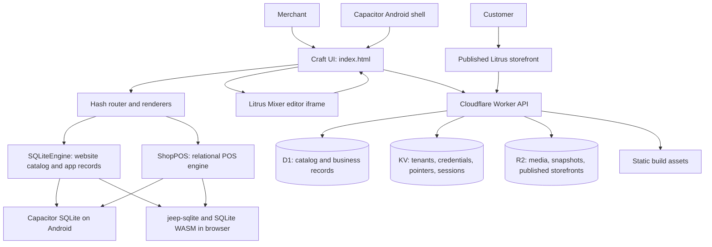

# Craft App Architecture — Current State

This document describes the application represented by the source in this
repository. It covers the mobile/web frontend, local data, the Cloudflare
backend, storefront publishing, integrations, and how the pieces connect.
Implementation details can change; the source files named below are the
authority when this document and runtime behavior differ.

## 1. What the application is

Craft is a mobile-first web application packaged for Android with Capacitor.
It brings together:

- A website editor, Litrus Mixer (the only one), that produces a published
  customer storefront with a catalog, cart, checkout, holds and, for service
  shops, appointment requests.
- A merchant workspace for website setup, catalog management, orders, manual
  and Paystack payments, discount codes, bookings, owner alerts, reports and
  shop configuration.
- A point-of-sale (POS) register and local business record system.
- Optional Cloudflare-backed publishing and services for multiple shops.

The app is not a conventional frontend/backend pair where every screen reads
and writes to a remote API. Much of the app works against a local SQLite
database. The Cloudflare Worker is a separate hosted backend used for account
and shop access, publishing, customer storefront operations, and optional
business synchronization.

## 2. System map

### Main code areas

| Area | Source |
|---|---|
| Main application, routes, merchant renderers, the Litrus iframe host and publish flow, styles | `index.html` |
| Browser and native module startup | `src\bootstrap.js` |
| Catalog/app-data SQLite adapter | `src\sqlite.js`, `src\sqlite-snapshot.js` |
| POS database, screens, transactions, reports, scanning and sync | `src\pos.js` |
| Business reporting workspace and filters | `src\business-lens.js` |
| AI helper UI and local POS context preparation | `src\craft-ai.js` |
| Push subscription client | `src\business-notifications.js`, `public\sw.js` |
| Website editor (Litrus Mixer) and its picker entry | `public\litrus-mixer\index.html`, `src\theme-catalog.js` (one entry, `litrus-mixer`) |
| Published storefront runtime (live catalog, cart, checkout, holds, bookings) | `public\litrus-mixer\live-catalog.js` |
| Storefront SEO (tags, JSON-LD, sitemaps) | `cloudflare\seo.js` |
| Smoke and boot checks | `scripts\boot-smoke.mjs`, `scripts\litrus-browser-smoke.mjs`, `scripts\lint-inline-script.mjs` |
| Hosted API and storefront delivery | `cloudflare\worker.js` |
| Hosted schema history | `cloudflare\migrations\` |
| Cloudflare resource/route configuration | `cloudflare\wrangler.jsonc` |
| Android wrapper configuration and manifest | `capacitor.config.ts`, `android\app\src\main\AndroidManifest.xml` |

## 3. Frontend and startup

### Application shell and UI

`index.html` is the primary Vite entry and contains a large amount of the
application: the storefront markup and styles, merchant and Web Studio
renderers, initialization logic, event binding, and the `AppController`.
It is a vanilla JavaScript application rather than a React/Vue application.
The UI is generally rendered by producing HTML strings and assigning them to
the `#app` element.

Navigation uses URL hashes, for example `#/account/web/studio/store/products`
and `#/pos/catalogue/inventory`. `AppController.currentRoute()`,
`navigate()`, and `handleRoute()` in `index.html` interpret the route and
select the appropriate renderer. Global click handling intercepts in-app
links; browser hash changes drive back/forward navigation. This allows the
same app entry to work from a browser URL and inside the Capacitor WebView.

`StudioRenderers`, `StoreRenderers`, and `PageRenderers` provide most of the
screen HTML in `index.html`. POS screens are rendered by `ShopPOS` from
`src\pos.js`. Styles are primarily in the app HTML and supplemented by
module-specific stylesheets such as `src\browser-register.css`.

The Craft visual-system class is applied to app-shell routes. The website
editor route (`/account/web/site`) is deliberately excluded from that
app-only style gate so app-shell styling does not become storefront editor
styling.

### Startup sequence

1. Vite loads `index.html` and its `src\bootstrap.js` module.
2. `bootstrap.js` installs the browser/native module bridges, creates
   `window.ShopPOS`, and starts `initializeSQLite()`.
3. The POS engine initializes after SQLite is ready. `AppController.init()`
   waits for `window.ShopPOSReady` before it reads catalog state.
4. `SQLiteEngine.init()` restores the saved app snapshot or initializes its
   app catalog data. It handles the current startup catalog-import flow.
5. The app binds navigation and events and renders the URL's initial route.
6. In production, the module registers `public\sw.js` as the service worker.

The Capacitor module also listens for native back-button events and app URL
opens. Google sign-in can return through the `com.eshop.atelier://auth/google`
Android deep link declared in the manifest.

### Main screen families

- **Built-in storefront routes in the app:** `/categories`, `/category/...`,
  `/product/...`, `/search`, `/bag`, `/checkout`,
  `/checkout/confirmation`, `/favorites`, and `/pages/...`. The Craft app's
  `/` route is its owner launchpad. A shop's customers do not use these: the
  published tenant website is the Litrus storefront, served by the Worker at
  the shop's hostname.
- **Craft home and account:** `/`, `/account`, `/app-account`, and
  `/account/profile...`.
- **Web Studio and shop management:** `/account/web/studio/...`,
  `/account/main-shop...`, `/store/...`, `/account/products`,
  `/account/categories`, `/account/inventory`, `/account/tenants`,
  `/account/payments`, `/account/website...`, and `/account/web/pages`.
- **Point of sale:** `/pos` and `/pos/...`.
- **Website editing:** `/account/web/studio/websites/...` and
  `/account/web/site`; both the new-site flow and the edit flow open the
  Litrus Mixer editor in an iframe.

Web Studio groups screens into Dashboard, Store, CRM, Websites, and Payments.
Its Store tabs include products, categories, inventory, and orders and
bookings (online orders, manual payment recording, discount codes, owner alerts,
service appointment requests, holds).
The app also contains reporting screens for sales, visits, traffic,
performance, product intelligence, customers, finance, and marketing.

### Android and browser runtimes

`capacitor.config.ts` names the Android app `Craft` with application ID
`com.eshop.atelier`, serving the built `www` directory. A normal Android
build uses the configured app hostname. A development live-reload URL can be
supplied with `CAPACITOR_LIVE_RELOAD_URL`; that mode requires the development
server and phone-to-computer connection to remain available.

The Android plugin registry includes SQLite, app lifecycle/deep links,
in-app browser, camera, filesystem, sharing, ML Kit barcode scanning, and
text recognition. The manifest declares network, camera, and Bluetooth
permissions; platform and Android-version behavior may affect permission
prompts and scanner availability.

The browser/PWA SQLite path uses `jeep-sqlite` and SQLite WASM storage. The
service worker caches selected shell assets and successful same-origin GET
responses, but does not cache navigation requests; this is not a complete
offline snapshot of every app page or backend feature.

## 4. Local data and persistence

### App/catalog store

`src\sqlite.js` initializes the Capacitor SQLite connection named `eshop`.
On Android it uses the native Capacitor SQLite plugin. On the web it
initializes `jeep-sqlite` and saves the database to the browser store. Its
`window.ShopSQLite` bridge serializes operations through a queue and exposes
`load`, `save`, `query`, `run`, `execute`, `executeSet`, `scheduleSave`, and
`flush`.

The app-level `SQLiteEngine` in `index.html` reads/writes tables through that
bridge. It stores each row as a JSON payload in a table keyed by app dataset.
Current logical datasets include store settings, categories, products,
pages, inventory, favorites, cart items, orders, hero slides, plans,
analytics, tenant catalogs, website themes, visits/events, newsletter
records, booking holds, loyalty points, payment-method metadata, studio
settings, and main-store allocation records. This is separate from the
normalized relational tables used by POS.

The SQLite adapter can migrate an older browser `ESHOP_SQLITE_DB_V1`
snapshot. A one-time storefront catalog import runs only when the relevant
catalog is empty. Tenant selection and certain editor/appearance preferences
also use browser local storage; not every setting is kept in SQLite.

### POS database

The POS engine in `src\pos.js` creates relational tables in the same local
SQLite database, but keeps the POS catalog and records distinct from the
website catalog. Its schema includes:

- POS categories, products and settings.
- Sales, sale line items and payment entries.
- Invoices and invoice items.
- Expenses, cash movements and till closes.
- Suppliers, purchases and tickets where those workflows are used.
- Business instances for scheduled, timed, paused, and counted sessions.
- Cloud sync records/outbox and queued inventory events.
- Shared inventory, shared inventory events, and their line items.

Prices and amounts are stored as integer cents in the relational POS schema.
Foreign keys, uniqueness constraints, indexes, and stock checks protect
important local operations. POS handles sale creation, payment recording,
receipts, partial payments, invoices/quotations, purchases, cash handling,
settings, and reports. The POS screen and business analytics are computed
from recorded data; cost-based profit estimates are incomplete when buying
costs have not been recorded.

Products in the online catalog and POS catalog are not one universal product
table. The app has explicit import/bridge and shared-inventory features, but
users should not assume that every edit or stock movement automatically
propagates between both catalogs.

### Data ownership boundaries

| Data | Main location | Remote behavior |
|---|---|---|
| App website draft/catalog and local settings | Device/browser SQLite, with some local-storage preferences | A selected catalog can be published to its shop. |
| POS register and records | Device/browser SQLite | Optional Cloudflare business-record sync and inventory services. |
| Account and shop identity | Cloudflare D1/KV | Used for sign-in and shop-scoped authorization. |
| Published catalog and orders | Cloudflare D1 | Read publicly where the route allows; writes are action/auth dependent. |
| Product media and filled published storefronts | Cloudflare R2 | Served through constrained Worker routes and tenant paths. |
| Litrus design (HTML and recipe) | Iframe messaging, then saved in the app's workspace settings (local SQLite) | Saved locally until Publish. |

## 5. POS, reporting and auxiliary frontend modules

`src\pos.js` exports `createPosApp()`, which owns POS state and rendering,
database initialization and mutations, scanner integration, and sync
workflows. The user-facing areas include Sell, Overview, Catalogue
(products/categories/inventory/suppliers), Orders, invoices/quotations, Sales
and receipts, Customers, and More/settings.

Barcode/QR scanning uses native ML Kit where available and browser-based
scanner libraries where applicable. Text recognition and image matching
support product lookup/catalog workflows. These are assisted capture and
matching tools; the saved product and sale records remain in the local
database.

`src\business-lens.js` renders the more detailed business workspace. It
normalizes a snapshot, applies date/filter context, and derives sales,
channels, products, inventory, customers, finance, marketing, newsletter and
category views. Its observations depend on the input records and include
minimum-sample/cost-coverage limitations in the relevant views.

`src\craft-ai.js` adds the in-app assistant panel on eligible business
screens. It prepares a bounded local POS analytics context and calls the
Worker AI endpoint when available. It is not the source of truth for
transactions or accounting.

`src\business-notifications.js` handles browser push permission, subscription
creation and removal. `public\sw.js` displays push notifications and routes a
click back into the app.

## 6. Cloudflare backend

### Runtime and bindings

`cloudflare\worker.js` is the Cloudflare Worker entry point. The current
`cloudflare\wrangler.jsonc` configures:

- **D1 (`DB`)** for relational account, catalog, orders, analytics, inventory,
  and synchronization records.
- **KV (`TENANTS`)** for tenant metadata, hashes/pointers, temporary sessions
  and other keyed state.
- **R2 (`BUSINESS_ARCHIVE`)** for uploaded media, business snapshots, and
  published storefront output/assets.
- **Static assets (`ASSETS`)** from the app build output in `www`.

The Worker is configured for the root and wildcard shop hostnames under
`rrobin.co.ke`. It also supports custom-hostname tenant mapping when the
configured data and domain resources are available. The Worker can serve
static assets while handling API and storefront routes itself.

### API surface

The Worker dispatches routes in its `fetch()` method. The handlers below are
implemented in `cloudflare\worker.js`:

| API group | Main purpose |
|---|---|
| `/api/auth/...` | Auth configuration/session, account registration and login, recovery, logout, and Google OAuth start/callback/complete. |
| `/api/tenants...` | Tenant/shop creation and administration, deletion, usage, and owner-key provisioning. |
| `/api/catalog` | Read or publish a tenant catalog, including owner-only/private catalog data. |
| `/api/theme-publish`, `/api/media` | Publish the filled Litrus storefront HTML; upload tenant media. |
| `/api/images/search`, `/api/images/draft-search` | Image search for the editor (provider keys are optional). |
| `/api/orders` | Storefront order creation (customer, rate limited, server-priced); owner list and status updates. |
| `/api/store/orders/:order/payment` | Owner records a manual payment (cash, mobile money, bank, other). |
| `/api/store/discounts`, `/api/discounts/validate` | Owner discount-code CRUD; customer preview of a code. |
| `/api/store/notifications`, `.../read` | Owner alert feed (orders, bookings, holds, attention). |
| `/api/payments/paystack/...` | Bank/subaccount setup, account linking/default selection, payment initialization/verification, and the signed webhook. |
| `/api/service-appointments` (and `/availability`, `/payment`, `/manage`) | Service slots, customer appointment requests, owner actions (confirm, reject, cancel, reschedule, complete, no-show, deposit refunded), deposit payment status, and customer self-service by token (`/manage`: view, slots, cancel, reschedule). |
| `/api/product-interest`, `/api/product-holds` | Record product interest and customer holds; owner hold management. |
| `/api/newsletter/...` | Subscribe, confirm, unsubscribe, owner subscriber management, and campaign sending. |
| `/api/analytics/visit`, `/api/analytics/events` | Record and query visits; per-product event counters including funnel events. |
| `/api/business/branches`, `/api/business/sync` | Save and retrieve branch/business snapshots. |
| `/api/business/records` | POS record delta synchronization. |
| `/api/nearby/pairing` | Temporary pairing relay used to establish a nearby device connection. |
| `/api/inventory/connect`, `/api/inventory/sale`, `/api/inventory/allocations` | Connect and transact against shared/allocated inventory. |
| `/api/push/...` | Push configuration, subscription lifecycle and broadcast. |
| `/api/ai/assistant` | Server-side AI assistant request. |
| `/api/custom-hostnames`, `/api/search-console/verification` | Custom-domain management and verification configuration. |
| `/themes/<id>/<asset>` | Public non-HTML assets from R2 for retired themes; raw HTML is refused. `/theme-skeletons/*` returns 404. |

Non-API routes: `/` (the official Craft homepage on the apex unless a main-shop storefront is published, otherwise the shop's storefront), `/robots.txt`, `/sitemap.xml`, `/sitemap-main.xml`, `/manifest.webmanifest`, `/shops`, and `/products/<slug>` for Litrus shops.

The detailed request and response shapes for the commerce endpoints (orders, discounts, manual payments, notifications, holds, rate limits, settlement) are in `cloudflare/STOREFRONT_COMMERCE.md`, which is the contract.

The route list describes implemented handlers, not a guarantee that every
optional external service is configured in every environment.

### Authentication and tenant isolation

The Worker distinguishes the Cloudflare administrator credential, a
shop-scoped owner key, and a signed-in app account session. Account password
handling and session validation live server-side. The Worker stores hashes
for shop credentials/session tokens rather than requiring the app to ship a
master administrative key. Account/tenant association and account-related
records live in D1; tenant metadata and session-related keyed state use KV.

Requests identify a tenant from the tenant query/host mapping and pass
through action-specific authorization checks. Public storefront catalog
reads and customer-facing actions are distinct from owner operations such as
private catalog access, publishing, and business record sync. Do not treat
all `/api/*` routes as public or all shop operations as authenticated in the
same way; consult each handler in `cloudflare\worker.js`.

Turnstile, Google OAuth, email, push signing, AI provider credentials,
Paystack secrets, and administrator/publish credentials depend on runtime
configuration. Secret values must remain in Cloudflare secret storage or
other protected deployment configuration, never in the app bundle or this
document.

## 7. Storefront publishing and customer flow

### Catalog and Litrus publishing

1. The merchant selects the active shop/tenant in Craft. Local drafts and
   catalog edits are scoped to that tenant. A brand-new shop is a local draft
   that makes no Cloudflare calls until final setup.
2. Craft hosts the Litrus Mixer editor in an iframe
   (`/litrus-mixer/index.html?craft=1`) and talks to it with `postMessage`
   restricted to the same origin: Craft sends the catalog, store details,
   saved recipe and theme colours; the editor sends back drafts, image
   requests (proxied to `/api/images/search`), mode changes and the publish
   request. The editor bakes the design into one self-contained HTML document
   carrying `<meta name="eshop-filled-theme" content="litrus-mixer">`, which
   Craft stores in its workspace settings together with the recipe.
3. Publish uploads eligible images to `/api/media`, then `PUT /api/catalog`
   (D1 `catalog_snapshots`; purchase cost is kept in a separate private
   payload), then `POST /api/theme-publish` with the HTML and the catalog
   version. A first publish does the same inside the new-shop setup and deletes
   the half-created shop if it fails.
4. The Worker validates the HTML (document, meta marker, no skeleton
   placeholders, size limit), checks the catalog version still matches (409
   otherwise) and that the catalog names the same theme, writes the page to R2
   (`published-sites/<tenant>/litrus-mixer/<version>-<id>.html`) and records
   the pointer in KV (`published-theme:<tenant>`).
5. When a catalog is saved without a republish, the Worker advances the stored
   page's version so the live catalog keeps flowing into it; visitors always
   get the last published design with current catalog data injected.
6. Requests to the tenant hostname resolve the pointer and R2 object, inject
   catalog data, SEO tags and the `paystack_connected` flag, and cache the
   page (at most an hour) by hostname and catalog version. Nothing published
   gives a plain "This website is not available" 404.

`craft-main-storefront` is the Craft platform's own storefront for the main
shop and is still an allowed theme ID in the Worker. The retired hosted themes
(`LEGACY_THEME_IDS` in `worker.js`) cannot be published any more (`422`),
but a shop that published one earlier keeps serving its stored HTML.

The theme catalog contains only Litrus Mixer. Unused code from the retired
engine may still exist (non-Litrus branches in `index.html`,
`public/theme-*.js`, `public/theme-packages/`, `src/liquid-*.js`); do not
treat it as live, and do not restore the removed themes.

### Storefront customer transactions

`public/litrus-mixer/live-catalog.js` runs inside the published page. It
re-reads the live catalog, and drives the customer flow:

- **Orders:** `POST /api/orders` with an idempotency key. The Worker prices
  the order from the published catalog (variants, delivery fee, free-delivery
  threshold, discount), checks stock and holds, and rate limits per IP. The
  customer either pays with Paystack (`/api/payments/paystack/initialize`,
  then `/verify`) or chooses a shop-settled order (`payment_method:
  "manual"`, email optional), which the owner later marks paid.
- **Settlement:** every payment path (manual, Paystack webhook, Paystack
  verify) is idempotent: stock is deducted once, holds are released, and
  problems such as short stock, payment after cancel or duplicate payment mark
  the order `needs_attention` and create an owner alert instead of losing
  money.
- **Discounts:** `/api/discounts/validate` previews; the order endpoint
  redeems atomically against `usage_limit`.
- **Holds:** `/api/product-holds`, auto-approved with caps.
- **Service appointments:** `/api/service-appointments/availability` lists 15
  minute-aligned slots from the shop's days, hours, timezone and buffer;
  `POST /api/service-appointments` creates a pending request that reserves
  the slot for 24 hours; the owner confirms or rejects (a deposit creates a
  Paystack link on confirm). A shop can allow several bookings at the same
  time (capacity). The customer gets a manage token (stored only as a hash);
  `POST /api/service-appointments/manage` lets them view, cancel or move the
  booking until the shop's cutoff, up to a reschedule limit. Owners can also
  cancel, reschedule and mark confirmed bookings completed or no-show once
  they have started. Cancelling a paid booking only sets a refund-due flag;
  the owner refunds in Paystack and marks it refunded. Worker defaults: capacity 1 (range 1-20), customers may cancel or move a booking until 2 hours before the start (0-168), at most 2 reschedules (0-10). These come from the shop's saved store settings (`service_capacity`, `service_cancel_cutoff_hours`, `service_max_reschedules`); no control for them was found in the owner app or the Litrus editor, so they stay at the defaults unless set another way.
- **Analytics:** visits, product interest and funnel events (`checkout_start`,
  `purchase`, `booking_submitted`).
- **Owner alerts:** order, booking, hold and attention events are written to
  `owner_notifications` and emailed best effort through Resend; they carry
  references and a first name only.

Payment confirmation is determined by the verification and webhook path, not
by a client-side success screen. A published online order is a hosted order; a
POS sale is a separate local register transaction unless an explicit
bridge/sync operation links them. A daily cron (`scheduled()`) deletes old
analytics, notifications, expired rate-limit counters and expired slots, and
sends best-effort reminder emails for confirmed bookings starting within
`SERVICE_REMINDER_WINDOW_HOURS` (default 36, at most 3 tries each; skipped
when Resend is not configured). The two jobs fail independently.

## 8. Hosted schema and storage

The D1 schema evolves through ordered SQL files in
`cloudflare\migrations\` (`0001` to `0030`). Files are applied in order and
released files are never edited; the next new file is `0031`. By group:

- `0001`-`0003`: tenant catalog snapshots and the private (owner-only) payload.
- `0004`, `0016`, `0017`: accounts, account-to-shop links, recovery email,
  Google identities.
- `0005`, `0020`: shared inventory with stock-check triggers, and main-store
  allocations.
- `0006`, `0007`, `0011`, `0012`: business branches, push/newsletter
  subscriptions, POS change log, storefront visits, nearby pairing relay.
- `0008`, `0010`, `0018`, `0022`: storefront orders and payment state,
  product interest and holds, daily event counters.
- `0009`, `0013`-`0015`, `0024`: Paystack subaccounts, reuse, pending setup,
  app-account defaults, live-account audit columns.
- `0019`: newsletter subscribers and campaigns. `0021`: custom hostnames.
- `0023`: service appointments and slot reservations.
- `0025`-`0029` (**not yet applied to production**): rate-limit counters and
  owner notifications (`0025`), manual payments and needs-attention flags
  (`0026`), discount codes (`0027`), payment attempts and discount release
  (`0028`), funnel events (`0029`).
- `0030` (**not yet applied to production**): service booking management
  (capacity, customer manage token, cancel/reschedule, completed and no-show,
  deposit refund flags, reminder tracking); it rebuilds the appointment and
  slot tables and keeps existing rows.

Apply `0025`-`0030` with `npm run cf:d1:migrate:remote` before deploying the
Worker code that needs them.

Catalog snapshots use tenant identifiers and serialized payloads. More
transaction-sensitive data—such as orders, payment status, inventory deltas,
and POS sync changes—uses relational rows and uniqueness/index constraints.
R2 object prefixes and KV keys also include tenant/theme/revision context so
the Worker can locate the right object and check publication metadata.

## 9. External services and integrations

- **Cloudflare Workers, D1, KV, R2 and static assets:** hosted backend,
  persistence, media, and storefront delivery.
- **Turnstile:** bot protection for account flows when configured.
- **Google OAuth:** optional sign-in via Worker callback and Android deep
  link.
- **Paystack:** optional online checkout/payment setup, verification, and
  webhook processing.
- **Email provider:** optional account recovery/newsletter messages.
- **Web Push:** service-worker push delivery when VAPID keys and user
  permission are available.
- **AI provider:** optional Worker-backed assistant.
- **Android ML Kit and Capacitor plugins:** native barcode/text scanning,
  camera, file/share, browser, lifecycle and SQLite features.

These are integrations behind app or Worker modules, not built-in
guarantees: the corresponding credentials, domains, permissions and remote
resources have to be configured and available.

## 10. Build, run, deploy and test

`vite.config.js` builds `index.html` into `www`; it would add `register.html`
as another entry only if that file existed. It does not exist: the standalone
browser register page was removed, and `src\browser-register.js` is an unused
leftover. `www` is also what the Worker serves as static assets.

Common package scripts in `package.json`:

| Command | Purpose |
|---|---|
| `npm run dev` | Start the Vite app for browser/live-reload development. |
| `npm run build` | Produce the static app build in `www`. |
| `npm run cap:sync` | Build and synchronize web assets/plugins to Capacitor platforms. |
| `npm test` | Run every Node test file under `tests`. |
| `npm run lint:inline` | Lint the inline application script in `index.html`. |
| `npm run test:boot` | Boot the production build (`www`) in headless Chromium; run `npm run build` first. |
| `npm run test:litrus-browser` | Playwright smoke test of the Litrus Mixer editor and preview. |
| `npm run test:pos` | Run POS-focused integration tests. |
| `npm run test:cloudflare` | Run Worker/backend tests. |
| `npm run cf:dev` | Build and run the Worker locally with Wrangler. |
| `npm run cf:d1:migrate:local` / `npm run cf:d1:migrate:remote` | Apply D1 migrations locally or to production. |
| `npm run cf:deploy` | Build and deploy the configured Worker/assets to production. |

Deploying is a manual, owner-run step: apply migrations first, then deploy. Nothing in the repository does it automatically, and automated agents must not. The checklist is in `README.md`.

`tests\` contains focused tests for POS flows, Worker routes and persistence
(`cloudflare.worker.test.mjs` runs the migrations on sql.js), Litrus storefront
behaviour, owner commerce screens, SEO, and other features; a few older tests
still cover retired theme code. Test coverage
does not imply that every remote integration has been exercised against
production services.

## 11. Current boundaries and verification notes

- The primary application UI/controller remains concentrated in
  `index.html`; changes to route rendering, app data, or cross-screen event
  behavior may affect several product areas.
- Catalog/app records use JSON-payload tables; POS uses relational tables.
  Treat these as separate data models even though both are accessed through
  the same local SQLite connection.
- Device-local persistence is the default for drafts and POS. Cloud
  publishing, account access, POS sync, payment processing, and email each
  have separate flows and setup requirements.
- A successful local build verifies bundling, not Worker credentials,
  Cloudflare resources, custom DNS, payment provider configuration, or live
  customer behavior.
- `PROJECT_LOG.md` and `ROADMAP.md` are history. `README.md`,
  `APP_OVERVIEW.md`, `APP_GUIDE.md` and `cloudflare/STOREFRONT_COMMERCE.md`
  were brought in line with the code at the end of round 2; if they disagree
  with the code, the code wins.
- Known limits: cancelling a paid order neither restocks nor refunds;
  rate limits protect the database, not one shop's availability; Litrus shops
  have real URLs only for the home page and products; tests use sql.js and
  stubs, not real Paystack, Resend or Cloudflare.
